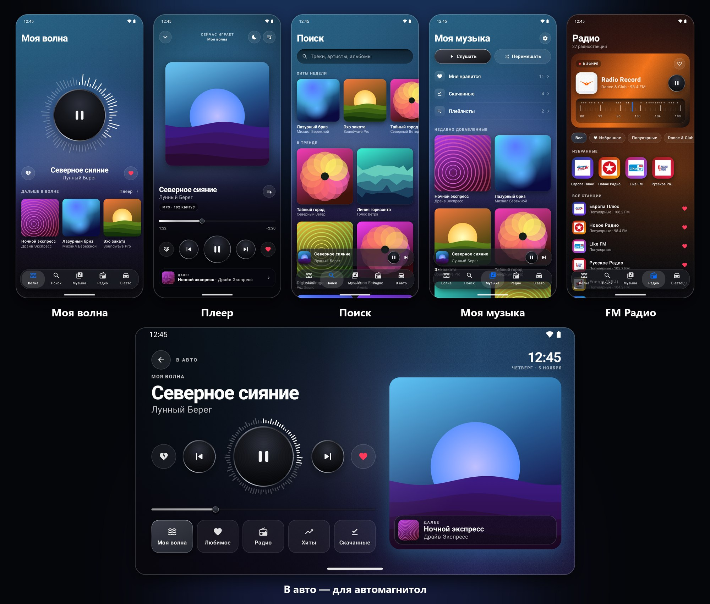
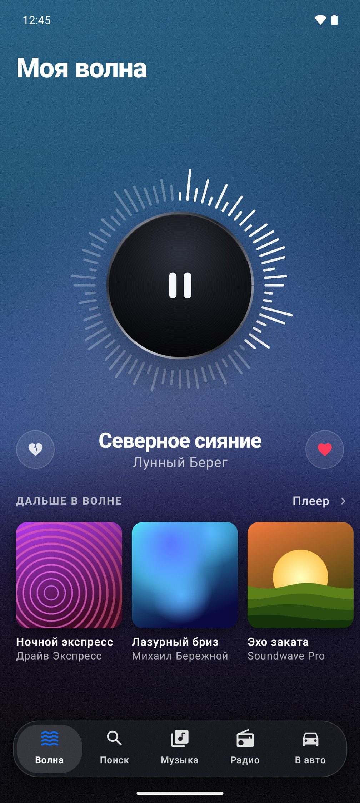
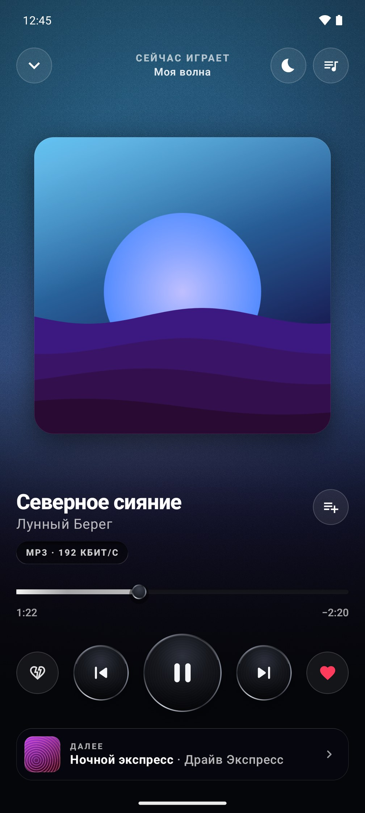
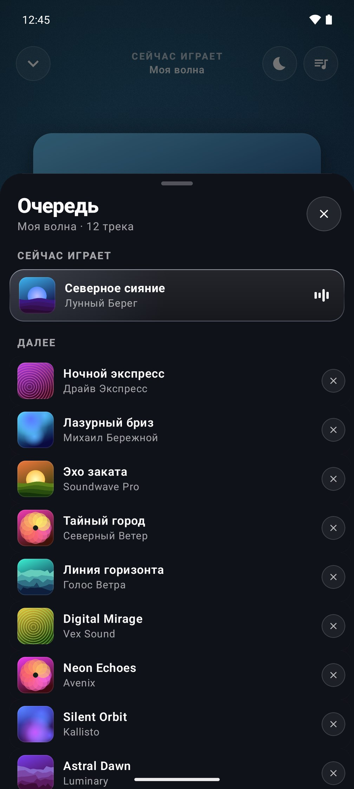
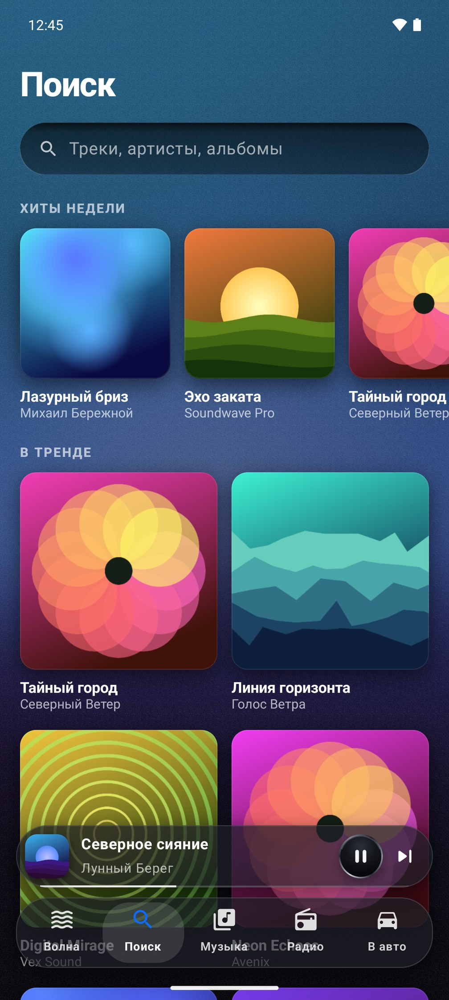
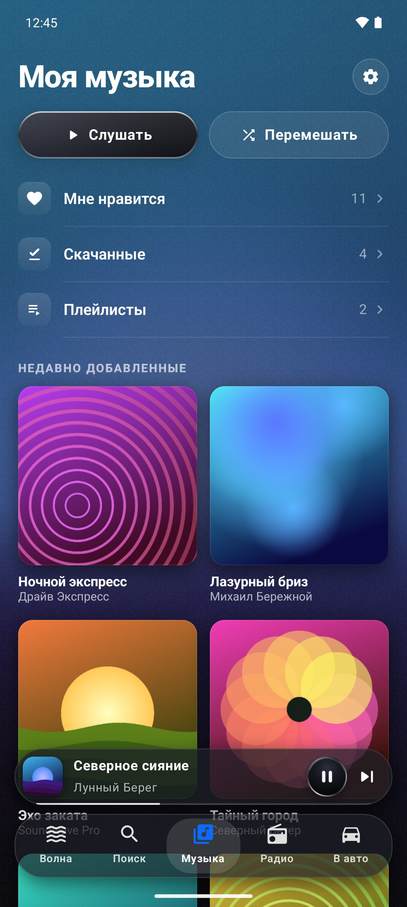
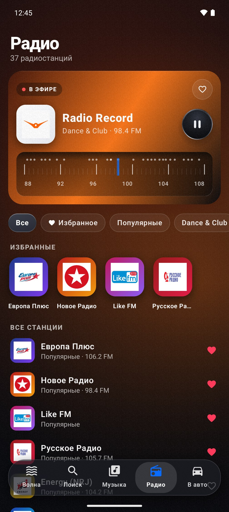
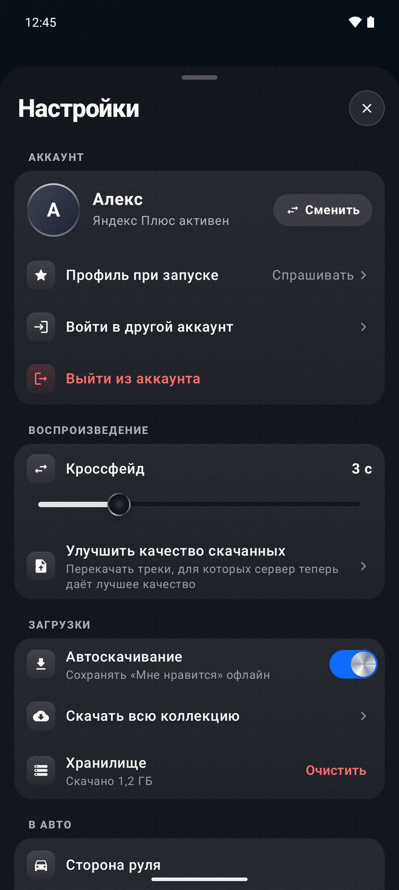
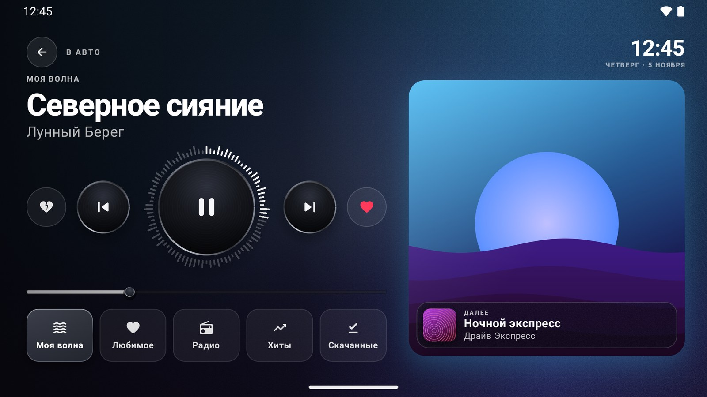

# 🎵 Yandex Music Lite

<div align="center">


# Yandex Music Lite

[](https://korenskoyr.github.io/YandexMusicLite/)
[](https://android.com)
[](https://github.com/KorenskoyR/YandexMusicLite/releases)
[](https://github.com/KorenskoyR/YandexMusicLite)
[](LICENSE)
[](https://kotlinlang.org)
[](https://developer.android.com/jetpack/compose)

### Быстрый и лёгкий плеер Яндекс Музыки для Android

Создан для смартфонов, планшетов и автомагнитол — быстро запускается, не перегружает память и играет музыку без рекламы. Выглядит как дорогая аудиотехника: металлические ручки, матовое стекло и живой фон из обложки.

[🌐 Официальный промо-сайт](https://korenskoyr.github.io/YandexMusicLite/) • [📥 Скачать актуальный APK](https://github.com/KorenskoyR/YandexMusicLite/releases/latest) • [📸 Скриншоты](#-скриншоты-интерфейса) • [✨ Особенности](#-главные-особенности) • [🚗 В автомобиле](#-специально-для-автомобиля-car-mode) • [🛠 Сборка](#-сборка-из-исходников)

</div>

---

## 📸 Скриншоты интерфейса

<div align="center">
  
</div>

<details>
<summary><b>🔍 Посмотреть отдельные экраны в полном разрешении</b></summary>
<br/>

<div align="center">

| [🌊 Моя волна](docs/assets/wave.jpg) | [▶️ Плеер](docs/assets/player.jpg) | [📋 Очередь](docs/assets/queue.jpg) |
| :---: | :---: | :---: |
| <a href="docs/assets/wave.jpg"></a> | <a href="docs/assets/player.jpg"></a> | <a href="docs/assets/queue.jpg"></a> |

| [🔍 Поиск](docs/assets/search.jpg) | [🎵 Моя музыка](docs/assets/library.jpg) | [📻 FM Радио](docs/assets/radio.jpg) |
| :---: | :---: | :---: |
| <a href="docs/assets/search.jpg"></a> | <a href="docs/assets/library.jpg"></a> | <a href="docs/assets/radio.jpg"></a> |

| [⚙️ Настройки](docs/assets/settings.jpg) | [🚗 Режим «В авто»](docs/assets/car.jpg) |
| :---: | :---: |
| <a href="docs/assets/settings.jpg"></a> | <a href="docs/assets/car.jpg"></a> |

Треки и обложки на скриншотах придуманы для примера.

</div>

</details>

---

## ✨ Главные особенности

- 🌊 **«Моя волна» в одно касание**: персональный поток музыки на главной странице. Сразу видно, что играет и что будет дальше, а кольцо спектра вокруг кнопки показывает, сколько трека прошло.
- ⚡ **Быстрый старт и отзывчивость**: приложение быстро открывается и работает плавно даже на бюджетных смартфонах и китайских магнитолах, а на слабых устройствах само включает облегчённый режим анимаций.
- 🚗 **Удобный режим для авто (Car Mode)**: экран как приборная панель — крупные ручки, таймлайн, часы и быстрое переключение между волной, любимым и радио.
- 🎨 **Дизайн Hi-Fi**: тёмная тема, металлические ручки и матовое стекло, а цвет всего приложения берётся из обложки играющего трека.
- 👆 **Плеер и очередь под пальцем**: плеер тянется за пальцем вверх и вниз, трек меняется свайпом по обложке, жест «Назад» на Android 14+ показывает, куда вы вернётесь. Треки в очереди можно перетаскивать и убирать свайпом.
- ❤️ **Лайк из шторки**: «Не нравится» и сердечко в плеере в шторке, на экране блокировки и в Android Auto.
- 📻 **Эфирное FM Радио**: 37 популярных радиостанций в прямом эфире — шкала приёмника, избранное и категории, от танцевальной музыки до рока и новостей.
- ❤️ **Вся медиатека под рукой**: любимые треки из раздела «Мне нравится», новинки, поиск по каталогу, чарты хитов и трендов.
- ✏️ **Свои плейлисты**: создавайте, переименовывайте и удаляйте плейлисты, добавляйте и убирайте треки, меняйте порядок перетаскиванием, делайте их публичными или приватными — правки сразу видны и в официальном приложении.
- 🎤 **Исполнители и альбомы**: отдельные страницы артистов и альбомов с популярными треками и дискографией, ряды в поиске и список недавних запросов.
- 📶 **Музыка не прерывается**: следующие треки и их обложки подгружаются заранее, поэтому при нестабильном интернете, в тоннелях или на загородных трассах всё появляется без пауз.
- 💾 **Офлайн-режим**: сохраняйте любимое на устройство и слушайте без интернета; библиотека хранится в локальной базе и открывается мгновенно.
- 🔍 **Масштаб интерфейса**: авто-подбор под плотность экрана или ручная регулировка 50–200% — спасает автомагнитолы, где интерфейс выходит слишком мелким или крупным.
- 📱 **Виджет «Сейчас играет»**: обложка и кнопки управления прямо с рабочего стола, без открытия приложения.
- 🔄 **Встроенные обновления**: приложение само проверит наличие свежей версии на GitHub и обновится в пару касаний. Не хотите эту версию — пропустите её: окно вернётся только со следующей.
- 🛠 **Журнал сбоев**: если что-то пошло не так, отчёт можно отправить разработчику — данные входа в него не попадают.
- 🛡️ **Чистый звук без мусора**: никакой рекламы, навязчивых баннеров, скрытых трекеров и фоновых процессов.

---

## 🚗 Специально для автомобиля (Car Mode)

Автомобильный интерфейс спроектирован с заботой о комфорте и безопасности в поездках:
- **Крупные элементы**: большие металлические ручки управления, по которым легко попадать с водительского места.
- **Таймлайн без лишних цифр**: плавная полоса с перемоткой пальцем; у радио вместо неё линия «В эфире».
- **Сторона руля**: выберите, с какой стороны руль — кнопки управления встают ближе к водителю, а обложка уходит на дальнюю сторону.
- **Масштаб под экран**: режим «Авто» сам подбирает размер интерфейса под плотность экрана магнитолы (частая беда — «плотный экран, но заниженный DPI»), есть и ручная регулировка.
- **Быстрый доступ**: переключение между «Моей волной», любимыми песнями, радио, хитами и скачанной музыкой в одно касание.
- **Встроенные часы**: крупное отображение времени и даты в стиле автомобильной панели.
- **Стабильный звук**: адаптировано под Android-магнитолы (Teyes, Kingbeats, Incar и др.) — звук воспроизводится плавно и чисто, без заиканий и эффекта ускорения.

---

## 📲 Как установить

1. Перейдите в раздел [**Releases**](https://github.com/KorenskoyR/YandexMusicLite/releases/latest) и скачайте файл **`YandexMusicLite.apk`**.
2. Откройте загруженный файл на вашем Android-устройстве.
3. При запросе системы разрешите установку из неизвестных источников.
4. Запустите **Yandex Music Lite** и авторизуйтесь через свой Яндекс ID — ваша музыка сразу появится в приложении!

> 💡 **Полезно знать:** Все последующие обновления приложение умеет скачивать и устанавливать автоматически через встроенный загрузчик в настройках.
>
> 💡 **Полезно знать:** Техподдержка осуществляется через ТГ бота: https://t.me/YandexMusicLite_bot
---

## 🛠 Сборка из исходников

Для самостоятельной компиляции проекта потребуется:
- **JDK**: 17 или новее
- **Android SDK**: API 37 (compileSdk), приложение поддерживает Android 8.0+ (API 26) и нацелено на Android 16 (API 36)
- **Gradle**: 9.x (включён gradlew wrapper)

```bash
# Клонирование репозитория
git clone https://github.com/KorenskoyR/YandexMusicLite.git
cd YandexMusicLite

# Отладочная сборка (ключ подписи не нужен)
./gradlew assembleDebug

# Тесты и статический анализ
./gradlew testDebugUnitTest lintDebug
```

---

## 🏗 Архитектура и стек технологий

- **Архитектурный паттерн**: Clean Architecture + MVVM; воспроизведение — процессный синглтон `PlaybackController`
- **UI Framework**: Jetpack Compose (Material 3, Edge-to-Edge, WindowInsets, predictive back)
- **Внедрение зависимостей**: Dagger Hilt
- **Аудио-движок**: AndroidX Media3 (два ExoPlayer с кроссфейдом, MediaLibraryService, MediaSession, возобновление с гарнитуры)
- **Сеть**: Retrofit 3, OkHttp 5, KotlinX Serialization
- **Асинхронность**: Kotlin Coroutines & StateFlow / SharedFlow
- **Хранение и кэш**: Room, DataStore Preferences, Coil 3 (три размера обложек, предзагрузка)
- **Фоновая работа**: WorkManager (офлайн-загрузки), Glance (виджет)
- **Оптимизация**: R8, Resource Shrinking, Baseline Profile

---

## 📄 Лицензия

Код проекта распространяется под лицензией [GNU GPL v3.0](LICENSE): его можно использовать и изменять, а если вы распространяете свою версию, она должна выходить под той же лицензией и с открытым кодом.

Лицензия относится только к коду этого проекта и не даёт прав на сервисы, ключи и материалы третьих лиц. Все права на товарные знаки и аудиоматериалы принадлежат их законным правообладателям.
