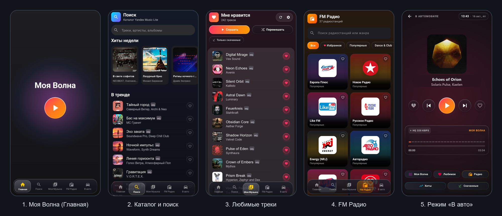
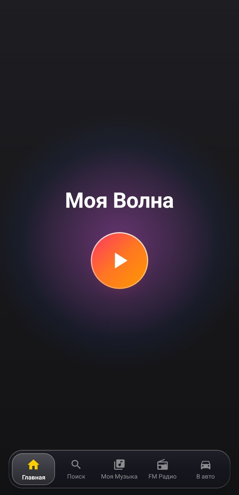
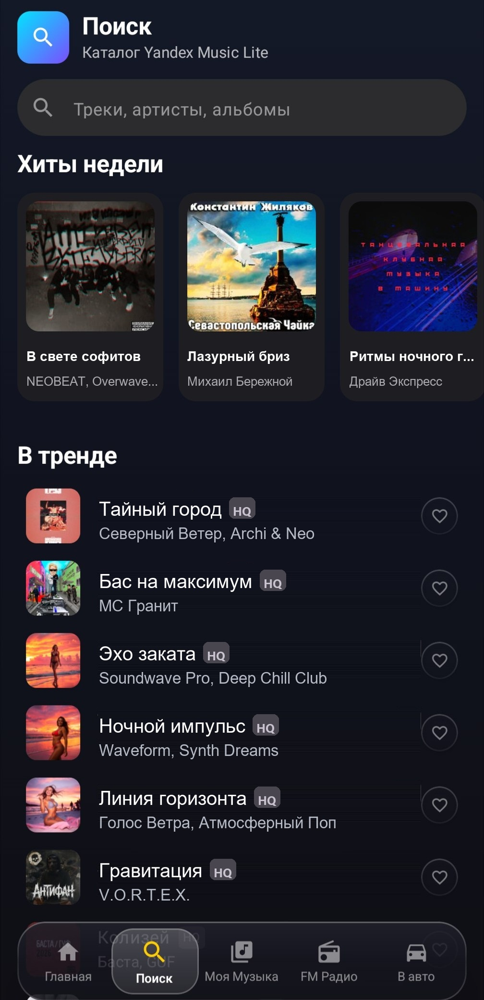
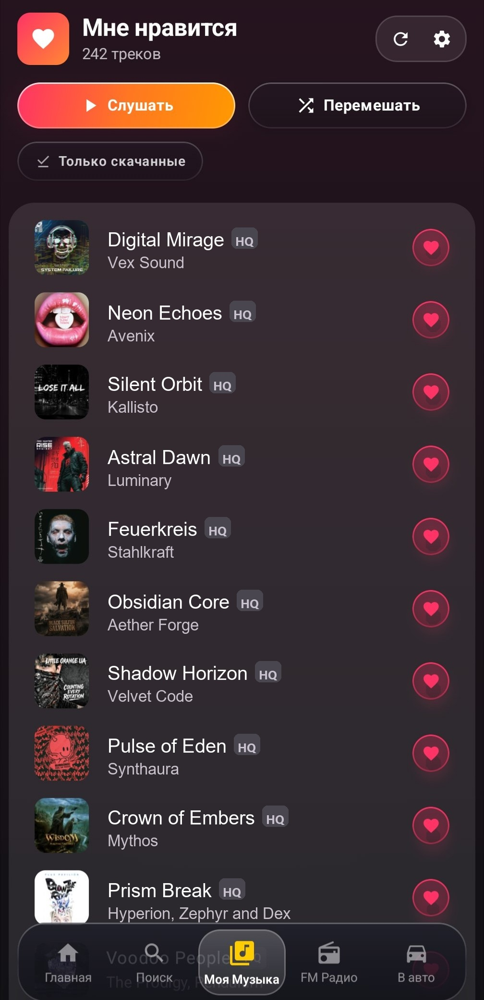
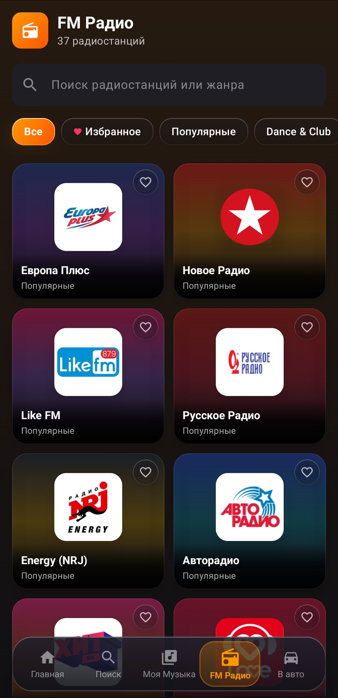
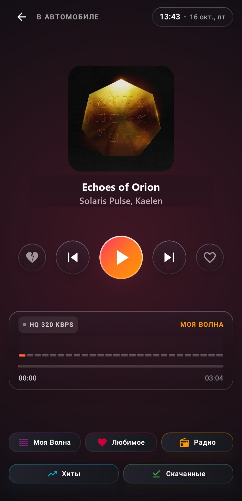

# 🎵 Yandex Music Lite

<div align="center">


# Yandex Music Lite

[](https://korenskoyr.github.io/YandexMusicLite/)
[](https://android.com)
[](https://github.com/KorenskoyR/YandexMusicLite/releases)
[](https://github.com/KorenskoyR/YandexMusicLite)
[](https://kotlinlang.org)
[](https://developer.android.com/jetpack/compose)

### Быстрый и лёгкий плеер Яндекс Музыки для Android

Создан для смартфонов, планшетов и автомагнитол — моментально запускается, не перегружает память и играет музыку без рекламы.

[🌐 Официальный промо-сайт](https://korenskoyr.github.io/YandexMusicLite/) • [📥 Скачать актуальный APK](https://github.com/KorenskoyR/YandexMusicLite/releases/latest) • [📸 Скриншоты](#-скриншоты-интерфейса) • [✨ Особенности](#-главные-особенности) • [🚗 В автомобиле](#-специально-для-автомобиля-car-mode) • [🛠 Сборка](#-сборка-из-исходников)

</div>

---

## 📸 Скриншоты интерфейса

<div align="center">
  
</div>

<details>
<summary><b>🔍 Посмотреть отдельные экраны в полном разрешении</b></summary>
<br/>

<div align="center">

| [🌟 1. Моя Волна (Главная)](docs/assets/1.jpg) | [🔍 2. Каталог и поиск](docs/assets/2.jpg) | [❤️ 3. Любимые треки](docs/assets/3.jpg) |
| :---: | :---: | :---: |
| <a href="docs/assets/1.jpg"></a> | <a href="docs/assets/2.jpg"></a> | <a href="docs/assets/3.jpg"></a> |

| [📻 4. FM Радио](docs/assets/4.jpg) | [🚗 5. Режим «В авто»](docs/assets/5.jpg) |
| :---: | :---: |
| <a href="docs/assets/4.jpg"></a> | <a href="docs/assets/5.jpg"></a> |

</div>

</details>

---

## ✨ Главные особенности

- 🌊 **«Моя волна» в одно касание**: включите персональный поток музыки, который моментально подстраивается под ваш вкус. Нажали одну кнопку — и треки играют бесконечно, без повторов одного и того же.
- ⚡ **Мгновенный старт и отзывчивость**: приложение открывается за доли секунды, бережёт заряд аккумулятора и работает плавно даже на бюджетных смартфонах и китайских магнитолах.
- 🚗 **Удобный режим для авто (Car Mode)**: продуманный экран с крупными кнопками, часами и быстрым переключением между волной, избранным и радио. Комфортно управлять музыкой за рулём, не отвлекаясь от дороги.
- 🎨 **Эстетичный дизайн Liquid Glass**: стильная тёмная тема, парящие полупрозрачные панели, мягкие неоновые переливы и обложки высокого разрешения. Приятно пользоваться днём и не слепит глаза ночью.
- 📻 **Эфирное FM Радио**: 37+ популярных радиостанций в прямом эфире прямо в приложении — от танцевальной музыки до рока и новостей.
- ❤️ **Вся медиатека под рукой**: любимые треки из раздела «Мне нравится», новинки, поиск по каталогу, чарты хитов и трендов.
- ✏️ **Свои плейлисты**: создавайте, переименовывайте и удаляйте плейлисты, добавляйте и убирайте треки, меняйте порядок перетаскиванием, делайте их публичными или приватными — правки сразу видны и в официальном приложении.
- 🎤 **Исполнители и альбомы**: отдельные страницы артистов и альбомов с популярными треками и дискографией, ряды в поиске и список недавних запросов.
- 📶 **Музыка не прерывается**: умное упреждающее кэширование гарантирует плавное звучание даже при нестабильном интернете, в тоннелях или на загородных трассах.
- 💾 **Офлайн-режим**: сохраняйте любимое на устройство и слушайте без интернета; библиотека хранится в локальной базе и открывается мгновенно.
- 🔍 **Масштаб интерфейса**: авто-подбор под плотность экрана или ручная регулировка 50–200% — спасает автомагнитолы, где интерфейс выходит слишком мелким или крупным.
- 📱 **Виджет «Сейчас играет»**: обложка и кнопки управления прямо с рабочего стола, без открытия приложения.
- 🔄 **Встроенные обновления**: приложение само проверит наличие свежей версии на GitHub и обновится в пару касаний прямо из настроек.
- 🛠 **Журнал сбоев**: если что-то пошло не так, отчёт можно отправить разработчику — данные входа в него не попадают.
- 🛡️ **Чистый звук без мусора**: никакой рекламы, навязчивых баннеров, скрытых трекеров и фоновых процессов.

---

## 🚗 Специально для автомобиля (Car Mode)

Автомобильный интерфейс спроектирован с заботой о комфорте и безопасности в поездках:
- **Крупные элементы**: увеличенные кнопки управления воспроизведением, по которым легко попадать краем глаза с водительского места.
- **Сторона руля**: выберите, с какой стороны руль — кнопки управления встают ближе к водителю, а обложка уходит на дальнюю сторону.
- **Масштаб под экран**: режим «Авто» сам подбирает размер интерфейса под плотность экрана магнитолы (частая беда — «плотный экран, но заниженный DPI»), есть и ручная регулировка.
- **Быстрый доступ**: переключение между «Моей волной», любимыми песнями, радио и сохранённой музыкой в одно касание.
- **Встроенные часы**: крупное и контрастное отображение времени и даты в стиле автомобильной панели.
- **Стабильный звук**: адаптировано под Android-магнитолы (Teyes, Kingbeats, Incar и др.) — звук воспроизводится плавно и чисто, без заиканий и эффекта ускорения.

---

## 📲 Как установить

1. Перейдите в раздел [**Releases**](https://github.com/KorenskoyR/YandexMusicLite/releases/latest) и скачайте файл **`YandexMusicLite.apk`**.
2. Откройте загруженный файл на вашем Android-устройстве.
3. При запросе системы разрешите установку из неизвестных источников.
4. Запустите **Yandex Music Lite** и авторизуйтесь через свой Яндекс ID — ваша музыка сразу появится в приложении!

> 💡 **Полезно знать:** Все последующие обновления приложение умеет скачивать и устанавливать автоматически через встроенный загрузчик в настройках.
> 
> 💡 **Полезно знать:** Техподдержка осуществляется через ТГ бота: https://t.me/YandexMusicLite_bot
---

## 🛠 Сборка из исходников

Для самостоятельной компиляции проекта потребуется:
- **JDK**: 17 или новее
- **Android SDK**: API 37 (compileSdk), приложение поддерживает Android 7.0+ (API 24) и нацелено на Android 16 (API 36)
- **Gradle**: 9.x (включён gradlew wrapper)

```bash
# Клонирование репозитория
git clone https://github.com/KorenskoyR/YandexMusicLite.git
cd YandexMusicLite

# Отладочная сборка (ключ подписи не нужен)
./gradlew assembleDebug

# Тесты и статический анализ
./gradlew testDebugUnitTest lintDebug
```

---

## 🏗 Архитектура и стек технологий

- **Архитектурный паттерн**: Clean Architecture + MVVM; воспроизведение — процессный синглтон `PlaybackController`
- **UI Framework**: Jetpack Compose (Material 3, Edge-to-Edge, WindowInsets, predictive back)
- **Внедрение зависимостей**: Dagger Hilt
- **Аудио-движок**: AndroidX Media3 (два ExoPlayer с кроссфейдом, MediaLibraryService, MediaSession, возобновление с гарнитуры)
- **Сеть**: Retrofit 3, OkHttp 5, KotlinX Serialization
- **Асинхронность**: Kotlin Coroutines & StateFlow / SharedFlow
- **Кэширование**: DataStore Preferences, Coil 3
- **Оптимизация**: R8, Resource Shrinking, Baseline Profile

---

## 🔐 Безопасность

- Токен входа хранится зашифрованным (AES-256-GCM) ключом из Android Keystore и не попадает в резервные копии и логи.
- Сетевые запросы — только HTTPS; исключения сделаны лишь для радиостанций, которые вещают исключительно по HTTP.
- Встроенное обновление проверяет контрольную сумму SHA-256 файла из релиза GitHub, подпись, имя пакета и версию.
- `FALLBACK_SALT` в `Md5Helper.kt` — не секрет: это общеизвестная константа протокола загрузки треков Яндекс Музыки,
  которая есть в открытых клиентах и в любом APK. Её можно переопределить через `YANDEX_SALT` в `local.properties`.
- Каждый push проверяется на утечку секретов (gitleaks), тестами и lint в GitHub Actions.

---

## 📄 Лицензия

Распространяется бесплатно для личного использования. Все права на товарные знаки и аудиоматериалы принадлежат их законным правообладателям.
